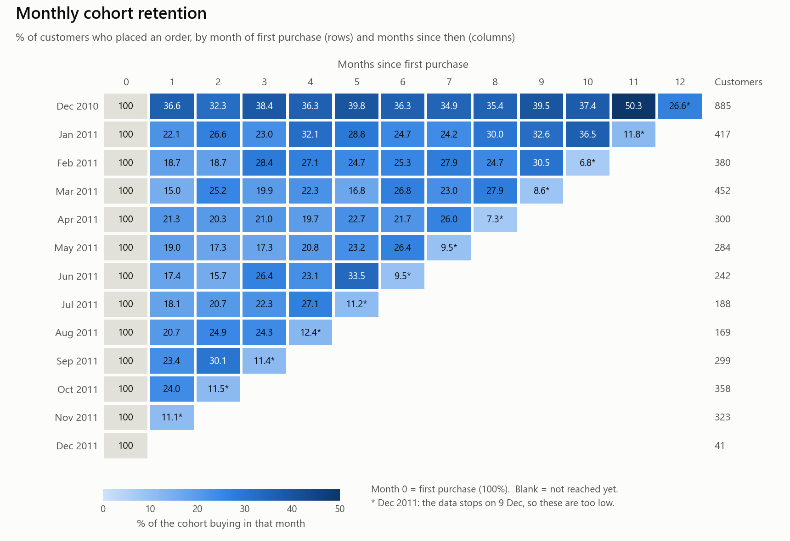

# Cohort Retention Analysis (SQL)

How many customers come back after their first order? This project groups the customers of a UK online gift shop into **monthly cohorts** (the month of their first purchase) and uses **PostgreSQL** to measure what share of each cohort orders again in each of the following months.

<p align="center">
  <picture>
    <source media="(prefers-color-scheme: dark)" srcset="images/cohort_retention_heatmap_dark.png">
    
  </picture>
</p>

## Dataset

[Online Retail](https://archive.ics.uci.edu/dataset/352/online+retail) from the UCI Machine Learning Repository: every transaction of a UK-based online shop between **1 Dec 2010 and 9 Dec 2011**. The shop mainly sells all-occasion gifts, and many of its customers are wholesalers. There are 541,909 rows, one per product line of an invoice. The script loads them into these columns (the CSV header has the same names in CamelCase, e.g. `InvoiceNo`):

| Column | Description |
| --- | --- |
| `invoice_no` | Invoice number. Starts with `C` if the invoice was cancelled |
| `stock_code` | Product code |
| `description` | Product name |
| `quantity` | Units on this line (negative for cancellations) |
| `invoice_date` | Date and time of the invoice. Day-first in the CSV: `1/12/2010 8:26` is 1 Dec 2010 |
| `unit_price` | Price of one unit, in GBP |
| `customer_id` | Customer number. Missing on a quarter of the rows |
| `country` | Customer's country |

Chen, D. (2015). *Online Retail* [Dataset]. UCI Machine Learning Repository. https://doi.org/10.24432/C5BW33 (CC BY 4.0).

## What's in this repo

| File | Description |
| --- | --- |
| [`Cohort.sql`](Cohort.sql) | All the SQL, in order: load, check, clean, top customers per country, cohort retention |
| [`Retail_Data.csv`](Retail_Data.csv) | Raw data (541,909 rows) |
| [`Cohort Retention Data.csv`](Cohort%20Retention%20Data.csv) | The result: size of each cohort and % of it active in months 0 to 12 |
| [`plot_retention.py`](plot_retention.py) | Draws the heatmap above from the result |
| [`images/`](images) | The heatmap (light and dark versions) |

## How it works

The numbered steps below match the sections of `Cohort.sql`.

### 1. Load

`COPY` loads the CSV into the `retail_data` table. The dates in the file are day-first but PostgreSQL reads them month-first by default, so the script first runs `SET DateStyle = 'ISO, DMY'`. Without it the load stops at `13/12/2010`.

### 2. Check the data quality

A single query measures every problem at once, using `COUNT(*) FILTER (WHERE ...)` to count only the rows that match:

| Problem | Rows |
| --- | ---: |
| No `customer_id` | 135,080 |
| `quantity <= 0`: 9,288 cancellations and 1,336 stock write-offs ("damaged", ...) | 10,624 |
| `unit_price <= 0` | 2,517 |
| Duplicates: extra copies of a row that's already there | 5,268 |

### 3. Clean

`clean_data` keeps the purchases of known customers, with one copy of each duplicated row (`SELECT DISTINCT *`):

| Step | Rows removed | Rows left |
| --- | ---: | ---: |
| Raw data | | 541,909 |
| No `customer_id`: a customer we can't identify can't be followed over time | 135,080 | 406,829 |
| `quantity <= 0`: cancellations, not purchases | 8,905 | 397,924 |
| `unit_price <= 0`: items given away for free | 40 | 397,884 |
| Duplicates | 5,192 | **392,692** |

Each step only counts the rows left after the previous one, so most numbers are smaller than in the table above. The cleaned data has **4,338 customers**, 18,532 invoices and 37 countries.

### 4. Top 3 customers by revenue in each country

Revenue is `SUM(quantity * unit_price)` per customer **minus their cancellations**, ranked within each country with `ROW_NUMBER() OVER (PARTITION BY country ORDER BY revenue DESC)`. Subtracting cancellations matters: one UK customer ordered 80,995 paper craft birdies (£168,470) and cancelled the order 12 minutes later, and counting the order alone would put them 3rd in the UK.

The biggest customer overall is 14646 in the Netherlands, with £279,489. The next-biggest Dutch customer spent £1,531.

### 5–7. Cohort retention

Three views, each built on the one before. You can query any of them on its own, e.g. `SELECT * FROM customer_months LIMIT 20;`

| View | One row per | Columns |
| --- | --- | --- |
| `customer_months` | customer and month in which they bought something | `customer_id`, `cohort_month`, `order_month`, `month_number` |
| `cohort_retention` | cohort and month | `cohort_month`, `month_number`, `customers`, `retention_pct` |
| `retention_matrix` | cohort (the final result) | `cohort_month`, `customers`, `month_0` … `month_12` |

- **`customer_months`**: `DATE_TRUNC('month', invoice_date)` turns every sale into its month. `MIN(order_month) OVER (PARTITION BY customer_id)` finds each customer's first month, which is their cohort. `month_number` counts the months since then as *years apart × 12 + months apart*, so Dec 2010 to Feb 2011 is `(2011 - 2010) * 12 + (2 - 12) = 2`. Customer 12347, for example, first bought in Dec 2010 and came back in months 1, 4, 6, 8, 10 and 12.
- **`cohort_retention`**: counts the customers of each cohort who bought in each month and divides by the month 0 count, the cohort size, taken with `FIRST_VALUE(customers) OVER (PARTITION BY cohort_month ORDER BY month_number)`.
- **`retention_matrix`**: pivots to one column per month with `MAX(retention_pct) FILTER (WHERE month_number = k)`. Months a cohort hasn't reached yet are left blank.

A customer counts as retained in month *k* if they bought anything in that month. They can skip months and come back later, which is why the percentages can go up as well as down.

## Results

The numbers are in the heatmap at the top and in [`Cohort Retention Data.csv`](Cohort%20Retention%20Data.csv).

- **About 1 in 5 new customers order again the next month.** Month 1 retention for the Jan to Oct 2011 cohorts goes from 15.0% (Mar 2011) to 24.0% (Oct 2011), 20% on average.
- **Retention doesn't keep falling after that.** The 2011 cohorts stay between 15% and 37% and rise towards the end of the year.
- **November is the best month.** For 10 of the 11 cohorts that reach it, Nov 2011 is their best month after the first purchase (36.5% of the Jan 2011 cohort, for example), most likely gift shops and wholesalers stocking up for Christmas.
- **The Dec 2010 cohort (32% to 50% in every full month) can't be compared with the others.** The data starts on 1 Dec 2010, so everyone who bought that month lands in this cohort, including loyal customers who had been buying long before.
- **The last value of each row (marked \*) is too low.** It's December 2011, and the data stops on 9 Dec. The Feb 2011 cohort, for example, goes from 30.5% in November to 6.8% in December: that's missing data, not customers leaving.

## Run it

1. Install [PostgreSQL](https://www.postgresql.org/download/) and a client (pgAdmin or psql), and clone this repo.
2. In `Cohort.sql`, change the path in the `COPY` statement to where you saved `Retail_Data.csv`.
3. Run the whole script: open it in pgAdmin's Query Tool and press F5, or use psql:

   ```bash
   psql -U postgres -d your_database -f Cohort.sql
   ```

   It can be run again at any time: it starts by dropping the tables and views it creates. The last query shows the retention matrix. To save it as a CSV in psql:

   ```sql
   \copy (SELECT * FROM retention_matrix ORDER BY cohort_month) TO 'Cohort Retention Data.csv' CSV HEADER
   ```

   In pgAdmin, *Save results to file* does the same.
4. If `COPY` fails with *permission denied*, the database server can't read the file (it needs superuser rights and access to your folder). Replace the `COPY` statement in the script with this line, which makes psql read the file on your side, and run the script with psql from the repo folder:

   ```sql
   \copy retail_data FROM 'Retail_Data.csv' WITH (FORMAT csv, HEADER true)
   ```

5. Optional, to redraw the heatmap from the CSV: `pip install pandas matplotlib`, then `python plot_retention.py`.

Tested with PostgreSQL 16.

## SQL used

Views (`CREATE VIEW`), CTEs (`WITH`), window functions (`MIN() OVER`, `FIRST_VALUE() OVER`, `ROW_NUMBER() OVER`), aggregate filters (`COUNT(*) FILTER (WHERE ...)`) for the checks and the pivot, date functions (`DATE_TRUNC`, `EXTRACT`, `TO_CHAR`), `SELECT DISTINCT`, `GROUP BY ... HAVING`, `CREATE TABLE ... AS` and `COPY`.
